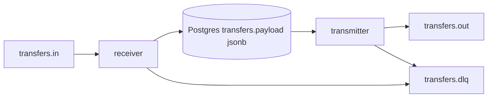
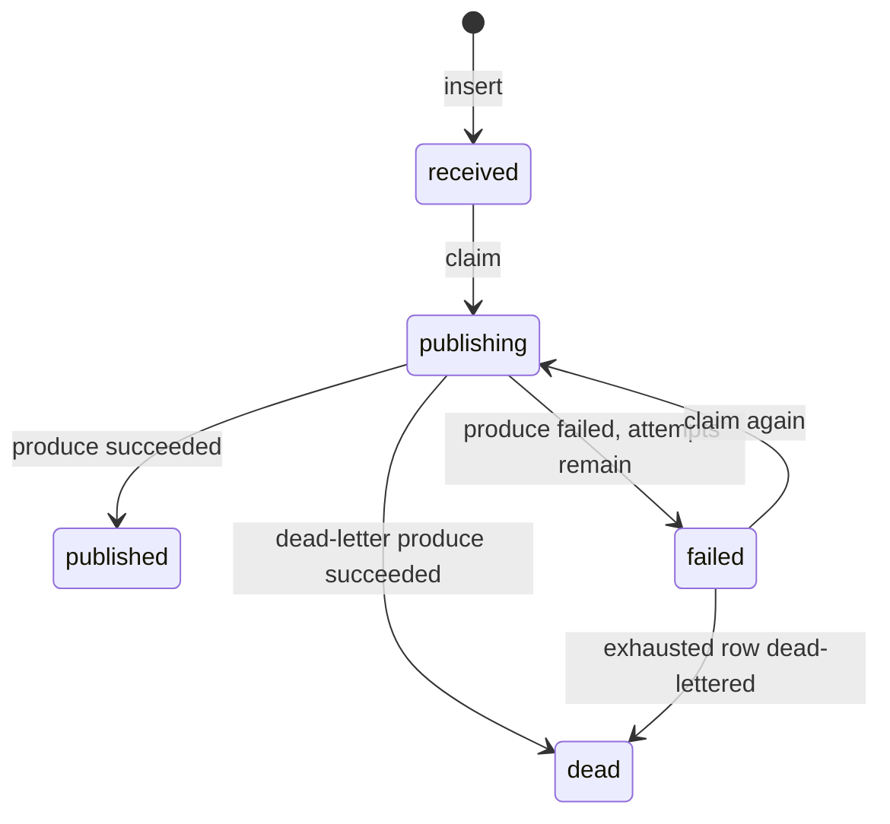
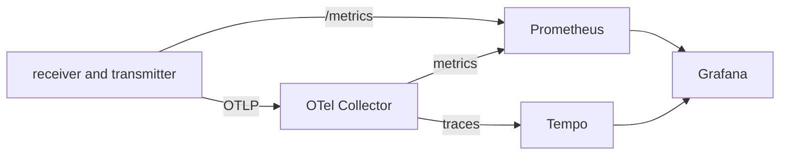

# Architecture

The service moves a JSON message from an inbound Kafka topic into PostgreSQL, then publishes that same JSON to an outbound topic. Kafka is the bus between the receiving end and the transmitting end. PostgreSQL is the durable record of each transfer.

One container image runs as two Kubernetes deployments. The receiver only consumes and inserts. The transmitter only reads the database and produces.



## Processes

| Process | Reads | Writes |
| --- | --- | --- |
| Receiver | `transfers.in` | `transfers` row, or `transfers.dlq` for a poison message |
| Transmitter | `transfers` rows waiting to leave | `transfers.out`, then `transfers.dlq` after the attempt cap |

The receiver commits a Kafka offset only after the insert succeeds, or after a poison message is accepted by the dead-letter topic. A database error or a failed dead-letter produce leaves the offset uncommitted, so Kafka delivers the record again.

The transmitter does not use a Kafka consumer group. It polls Postgres. Several transmitter replicas can run together because each claim uses `FOR UPDATE SKIP LOCKED`.

## Message and storage

A valid inbound value is one JSON object with a UUID `id`:

```json
{"id":"11111111-1111-1111-1111-111111111111","type":"transfer","payload":{"amount":10}}
```

That whole document is stored in `transfers.payload` as `jsonb`. The column has a check that the value is a JSON object. The transmitter publishes those same bytes. The business fields stay inside the JSON document. The table columns around it exist so the outbox can find, lock, and finish the row.

| Column | Role |
| --- | --- |
| `id` | Primary key, taken from the JSON `id`. Also the outbound Kafka key. |
| `message_key` | Inbound Kafka key, or the id when the key is empty. |
| `payload` | Original message JSON. |
| `source_topic`, `partition`, `kafka_offset` | Where the message was consumed. Unique together. |
| `status` | Outbox state. |
| `attempts`, `last_error`, `locked_at` | Retry and lease. |
| `received_at`, `published_at` | Timestamps. |

An insert uses `ON CONFLICT DO NOTHING`. A second delivery of the same id, or of the same source offset, does not replace the stored JSON.

A message that is not JSON, or whose `id` is not a UUID, is not inserted. The receiver publishes a JSON error document to `transfers.dlq` and then commits the source offset.

## Lifecycle



`publishing` is the in-flight claim. `locked_at` is the lease. If the transmitter stops after the claim and before it marks the row, another worker can claim that row once the lease expires. The default lease is two minutes. The default attempt cap is five.

`published` and `dead` leave the outbox. Outbox depth counts `received`, `publishing`, and `failed`.

Delivery is at-least-once. The outbound record key is the transfer id, so a downstream consumer can drop a duplicate. A crash after a successful produce and before `published` is written can publish the same JSON twice.

## Kafka

Local Kafka is one Apache Kafka 3.9 broker in KRaft mode. Clients use `kafka-0.kafka:9092` with `PLAINTEXT`. A job creates three topics, each with three partitions:

- `transfers.in`
- `transfers.out`
- `transfers.dlq`

The client is `franz-go`. Security settings use the Confluent names `KAFKA_SECURITY_PROTOCOL` and `KAFKA_SASL_MECHANISM`. Local pods stay on `PLAINTEXT`. Confluent Cloud is the same binary with `SASL_SSL` and a SASL username and password (`PLAIN`, `SCRAM-SHA-256`, or `SCRAM-SHA-512`).

Trace context travels in Kafka headers, so a span started on consume can continue on produce.

## Observability

Both processes expose `:8080` for `/healthz`, `/readyz`, and `/metrics`. Readiness checks Postgres. The receiver also pings Kafka.

Traces and metrics go to the OpenTelemetry collector over OTLP. The collector forwards traces to Tempo and exposes the OTLP metrics on a Prometheus endpoint. Prometheus also scrapes the receiver and transmitter directly. Grafana, on NodePort `30080`, has those two datasources and a Transfers dashboard: receive rate, publish rate, persist latency, publish latency, outbox depth, retries, errors, and dead letters.

JSON logs on stdout include `trace_id` and `span_id` when a span is active.



## Cluster

Terraform is split in two because the Kubernetes provider needs a kubeconfig that already exists.

1. `terraform/cluster` creates a one-node kind cluster named `transfer` and writes `terraform/cluster/kubeconfig`. Grafana's NodePort `30080` is mapped to the host.
2. `terraform/platform` installs the namespace `transfer` and everything in it.

Platform pieces:

- local-path provisioner, so Kafka and Postgres keep a 1Gi volume across pod restarts
- Postgres 16, database `transfers`, user `transfer`
- Kafka and the topic job
- receiver and transmitter, image `transfer:local`, `imagePullPolicy: IfNotPresent`
- OpenTelemetry Collector, Prometheus, Tempo, and Grafana

Both deployments use that one image. The receiver command is `/receiver`. The transmitter command is `/transmitter`. Either process can apply the embedded SQL migration. A Postgres advisory lock keeps those startups from racing.

Startup and the Confluent Cloud environment variables are in the [README](../README.md).
